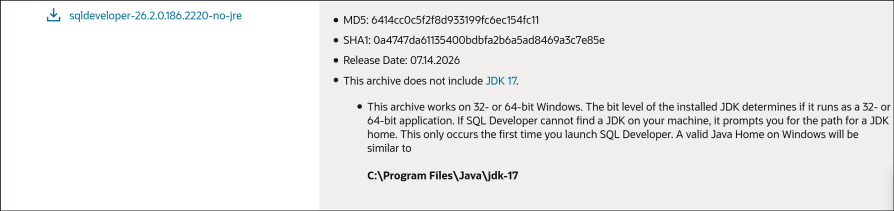
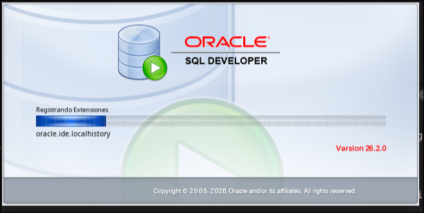
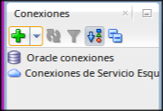
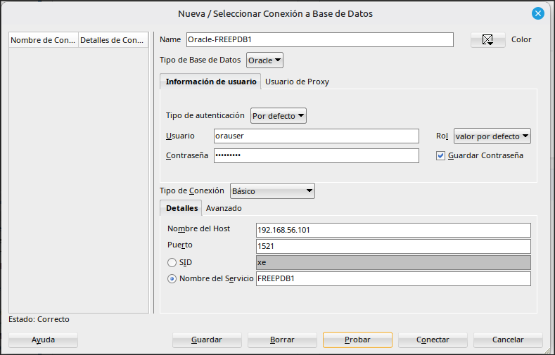
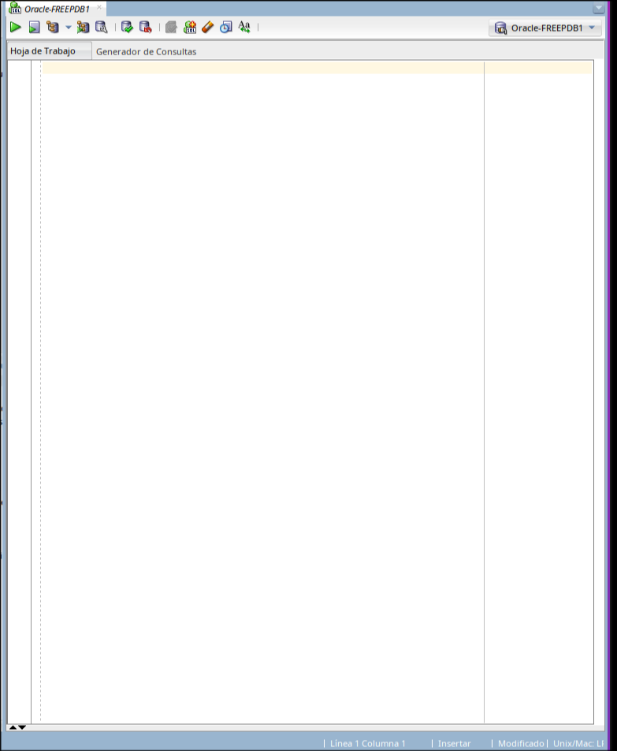
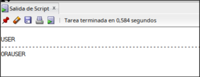
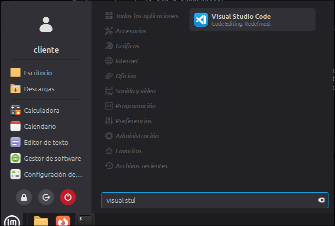

# Práctica 2.3.
## Instalar clientes para tres SGBD

Instalar y probar clientes de consola, gráficos y web para conectarte a Oracle Datbase 23ai Free, PostgreSQL y MariaDB

**(servidor)** = Maquina servidor

**(cliente)** = Maquina cliente

## 1. Clientes para Oracle Database
 
## Esta configuración inicial es necesaria para que el cliente pueda conectarse

## PostegreSQL
#### Vemos la versión de postgresql en nuestra maquina servidor (servidor)
`ls /etc/postgresql/`
**versión: 16**
#### Entramos en el archivo de configuración (servidor)
`sudo nano /etc/postgresql/16/main/postgresql.conf` *El numero dependera de tu versión*
Entramos en el fichero y con `CTRL + W` buscamos `#listen_addresses = 'localhost'.
Lo sustituimos por '*', esto hace que PostgreSQL escuche en todas las interfaces.

#### Vamos a dar permisos al cliente (servidor)
Pondremos este comando `sudo nano /etc/postgresql/16/main/pg_hba.conf`

Bajaremos al **final del archivo** y añadimos esta linea
`host    dbpg    pguser    192.168.56.102/32    scram-sha-256`

Esto le da permiso de conexión al cliente a postgreSQL mediante el usuario **pguser** y indicando que solo funcionara desde la ip `192.168.56.102/32`

Reiniciaremos el servicio **PostgreSQL** usando este comando
`sudo systemctl restart postgresql` **(servidor)**

## MariaDB
Entraremos en este fichero de configuración
`sudo nano /etc/mysql/mariadb.conf.d/50-server.cnf` **(servidor)**
Buscaremos con `Ctrl + W` bind-address, aquí encontraremos la ip de localhost
`bind-address            = 127.0.0.1` y la cambiaremos por esta `bind-address            = 0.0.0.0`

#### Crearemos un usuario para el cliente (servidor)
Pondremos `sudo mariadb`

Una vez dentro crearemos el usuario

`CREATE USER 'muser'@'192.168.56.102' IDENTIFIED BY 'TU_CLAVE';`
`GRANT ALL PRIVILEGES ON dbm.* TO 'muser'@'192.168.56.102';`
`FLUSH PRIVILEGES;`
`EXIT;`

Esto hace que el usuario **muser** pueda entrar desde la ip 192.168.56.102, antes solo podia desde localhost

#### Reiniciamos MariaDB (servidor)
`sudo systemctl restart mariadb`

### Comprobamos que oracle esta arrancado (servidor)
`sudo podman ps`

#### Estado
`CONTAINER ID  IMAGE                                                 COMMAND               CREATED     STATUS                      PORTS                   NAMES
24cec1af6024  container-registry.oracle.com/database/free:23.5.0.0  /bin/bash -c $ORA...  6 days ago  Up About an hour (healthy)  0.0.0.0:1521->1521/tcp  cont-oracle`

## Cliente

### Comprobaremos los puertos
`nc -zv 192.168.56.101 1521`
**Respuesta:** Connection to 192.168.56.101 1521 port [tcp/*] succeeded!
`nc -zv 192.168.56.101 5432`
**Respuesta:** Connection to 192.168.56.101 5432 port [tcp/postgresql] succeeded!
`nc -zv 192.168.56.101 3306`
**Respuesta:** Connection to 192.168.56.101 3306 port [tcp/mysql] succeeded!

#### Funciona todo correctamente pasemos a la configuración del cliente

## Clientes de Oracle

En el cliente hacemos
`sudo apt update
sudo apt install default-jdk unzip
java --version`

## Descargamos el .zip
Vamos a este enlace `https://www.oracle.com/database/sqldeveloper/technologies/download/` 

Descargamos esta opción

Entramos en Descargas
`cd ~/Descargas`

Descomprimimos el archivo .zip
`sudo unzip NOMBRE_DEL_ZIP.zip -d /opt/`

Ejecutamos el .sh
`/opt/sqldeveloper/sqldeveloper.sh`
*Si estamos conectados por SSH tendremos que ejecutarlo desde la propia maquina ya que se tiene que abrir una pantalla de SQL*

**Esta es lo que debe abrirse**

## Creamos una conexión manualmente

#### Ponemos estos datos en la nueva conexión

| Campo                       | Valor                       |
| --------------------------- | --------------------------- |
| **Name**                    | *Oracle-FREEPDB1*           |
| **Tipo de base de datos**   | *Oracle*                    |
| **Usuario**                 | *orauser*                   |
| **Contraseña**              | *TU_CLAVE*                  |
| **Tipo de conexión          | *Básico*                    |
| **Nombre del host**         | *192.168.56.101*            |
| **Puerto**                  | *1521*                      |
| **Nombre del servicio**     | *FREEPDB1* (marca esta opción, no SID |

#### Probamos esta conexión y si todo esta correcto le damos a conectar

**Se abrira esta hoja de trabajon y pondremos esto**
`SELECT USER FROM DUAL;`
*Ejecutamos*

**Debe devolver orauser para comprobar que esta correcto**

## Vscode

#### Vamos a la pagina oficial de visual studio code y descargamos el .deb
#### Una vez descargamos vamos a la carpeta descargas y ponemos este comando
`sudo apt install ./code_NOMBRE_DEL_ARCHIVO.deb`

#### Cuando acabe la instalación comprobamos que todo esta en orden con el comando
`code --version`

### Abrimos visual studio code (desde la maquina)

